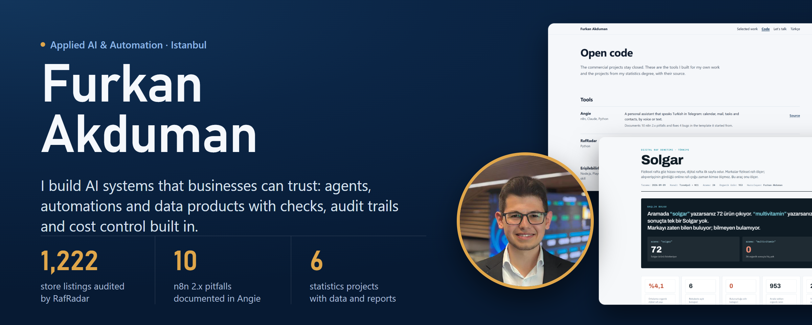
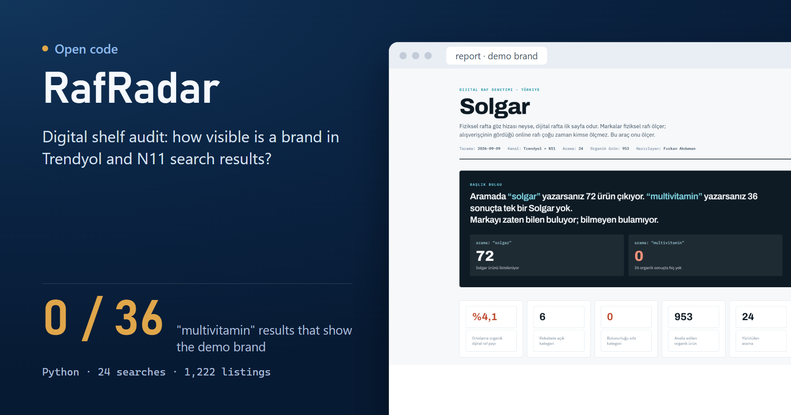
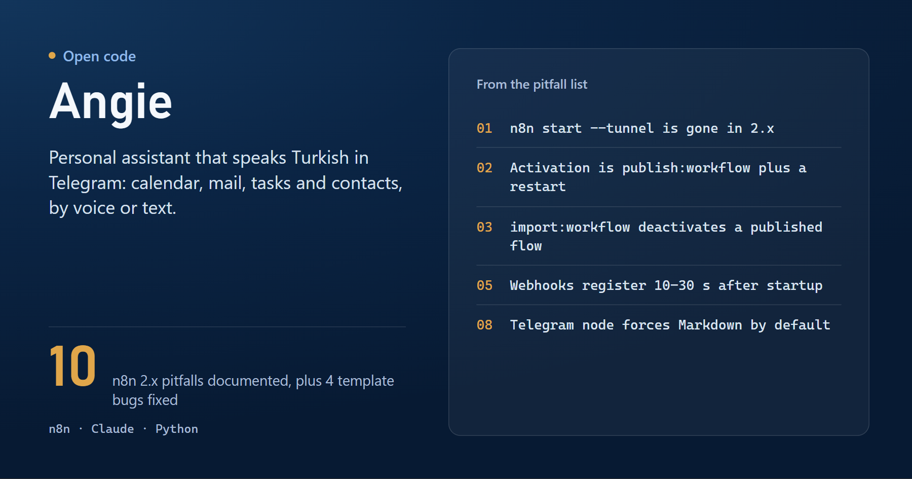
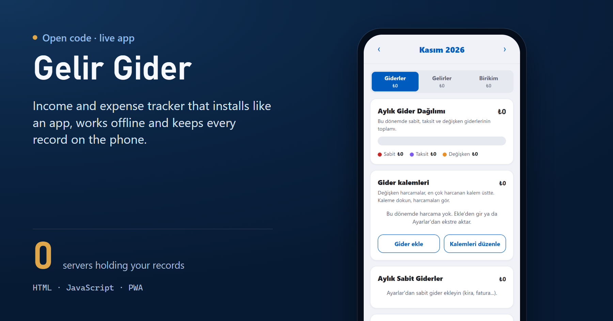
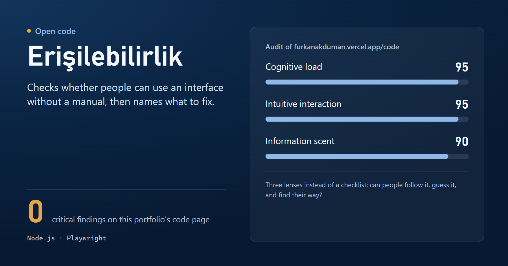
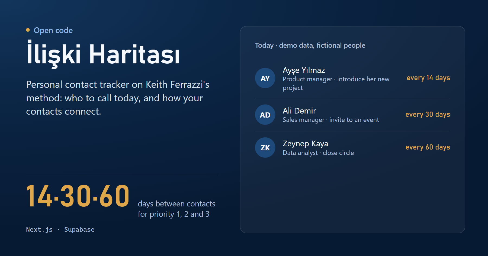
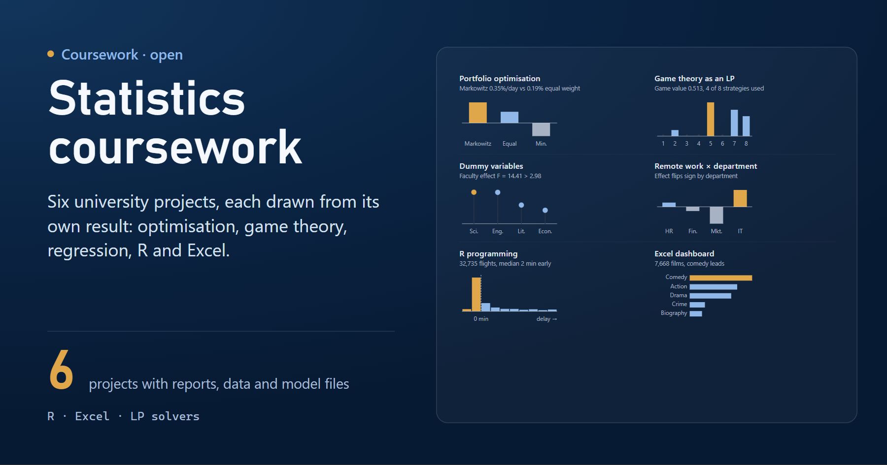

**Looking for:** AI Consultant or AI Automation roles. Full time from January 2027; open to relocation (EU, UAE, Americas) or remote.

Statistics student at Mimar Sinan Fine Arts University, Istanbul. Portfolio: **[furkanakduman.vercel.app](https://furkanakduman.vercel.app)** · [LinkedIn](https://www.linkedin.com/in/furkanakduman/)

### Selected work

Click a card for the code.

Also on the portfolio: [AI Quality Gate](https://furkanakduman.vercel.app/work/ai-quality-gate), which measures what an AI coding agent ships and decides when it may not decide alone, and [Outreach Research Agent](https://furkanakduman.vercel.app/work/outreach-agent), which researches a company and drafts a first message, evaluated on cost and errors.

### How I work

- **The engine produces the numbers; AI only interprets them.** Switching the AI layer off leaves every figure unchanged.
- **Missing data is never skipped silently.** A step that cannot run is reported with its reason.
- **Every system has an independent check.** Demo data carries an answer key the pipeline never reads.

Open repositories are free for noncommercial use (PolyForm Noncommercial 1.0.0); commercial use needs a licence.
